<!--
  NOUR IBRAHEM
  THE MIND SPACE — Developer Identity
  Visual language: neural networks / deep space / quiet technology
-->

 

 

  CODE &nbsp;·&nbsp; CREATE &nbsp;·&nbsp; CONNECT IDEAS &nbsp;·&nbsp; EXPLORE

---

## 01 / A little about me

I'm Nour, a developer from Egypt driven by curiosity about technology and the systems behind it.

I enjoy turning ideas into useful digital experiences — from thoughtful interfaces to the logic, data, and architecture that power them. I work mainly on the front end while continuously expanding into back-end engineering and AI.

- **Build** modern web applications and interactive user experiences.
- **Explore** APIs, databases, system design, and software architecture.
- **Experiment** with AI tools, model integration, and AI-assisted workflows.
- **Create** immersive experiences with 3D and motion on the web.

---

## 02 / My toolkit

**01 — Front-End**

  

**02 — Back-End & Data**

  

**03 — Creative Development**

 

  

**04 — Tools**

**AI & Development:** AI-assisted development · AI tools and model integration · Prompt engineering · AI-powered workflows

---

## 03 / GitHub activity

## 04 / Contribution trail

---

## 05 / Find me

  

“Stay curious. Build with purpose. Keep exploring.”

